# ABI Inspector Extended

**Version 2.6.4** · A local interface enhancement for the official Arena Breakout: Infinite Inspector.

ABI Inspector Extended elevates the Inspector experience with a modern metallic card layout, animated overview inspection progress bars, an in-depth in-site settings hub, an extension popup master switch, quick verdict hotkeys, precision video controls, full multi-language localization, and clean News and Challenges styling. It retains 100% of the official inspection workflows, verification protocols, and network safety.

> Independent community project. Not affiliated with or endorsed by the game’s publisher.

## Screenshots

All project screenshots live in [`screenshots/`](screenshots/). The Overview, Workbench, Test Cases, and Challenges captures use `***` to hide personal values.

### Overview and inspection

| Overview · Accuracy Board (EN) | Overview · German Localization (DE) |
| --- | --- |
| 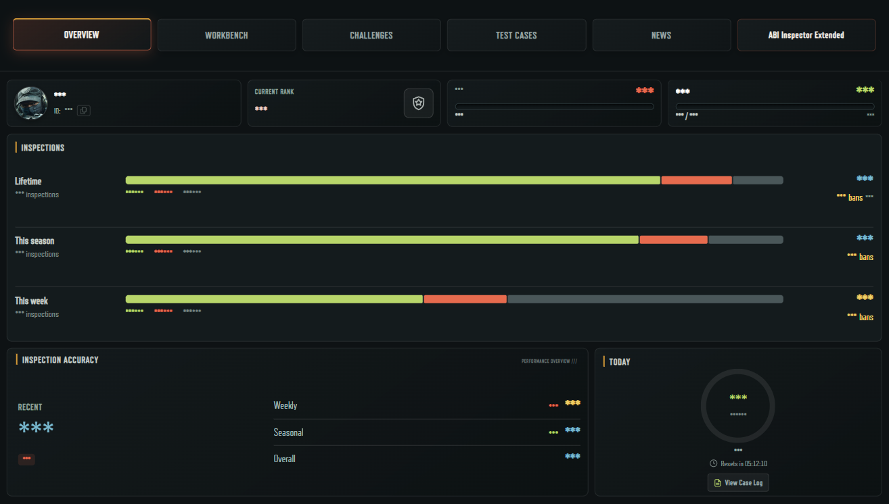 | 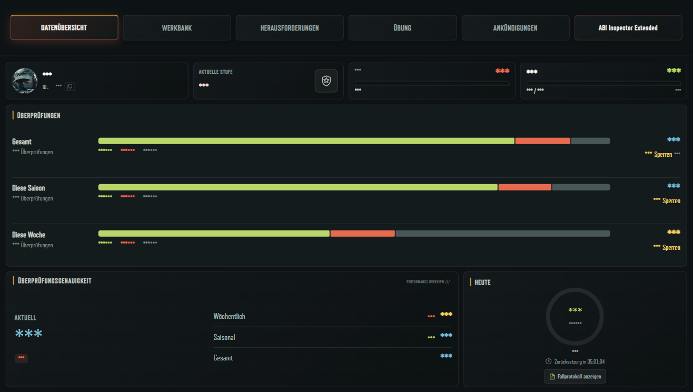 |

| Workbench · video controls | Test Cases |
| --- | --- |
| 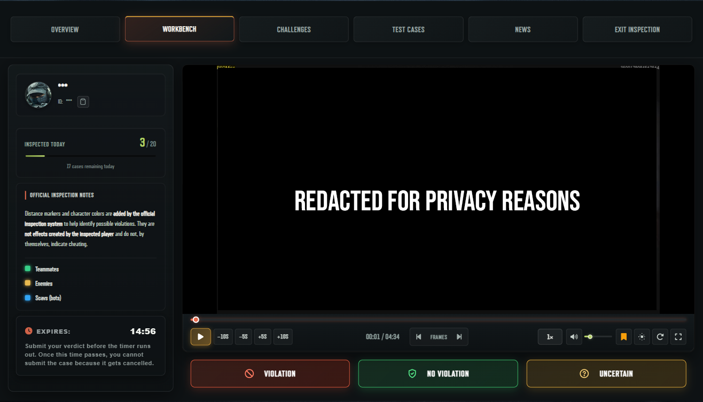 | 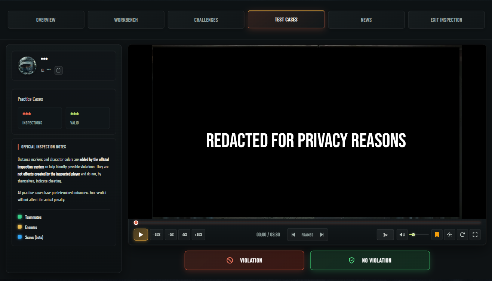 |

| Extension popup |
| --- |
| 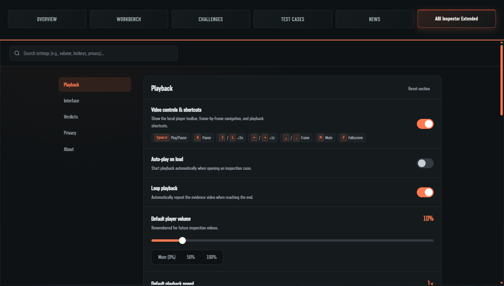 |

### Restyled Verdict Dialogs

| Violation | No Violation | Uncertain |
| --- | --- | --- |
| 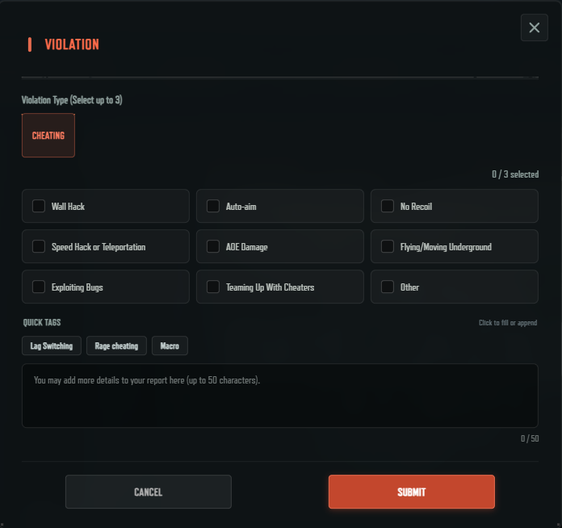 | 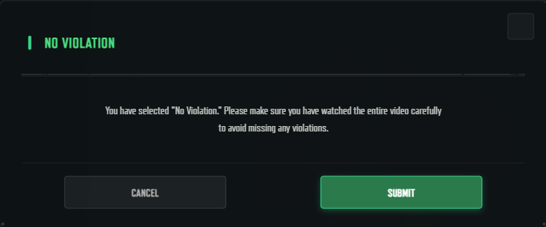 | 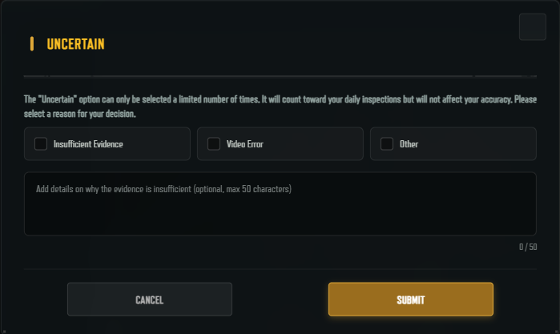 |

### Challenges and News

| Challenges | Penalty List | Inspection Guidelines |
| --- | --- | --- |
| 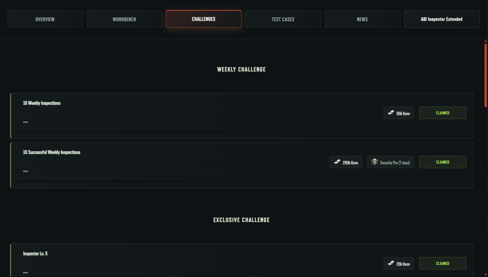 | 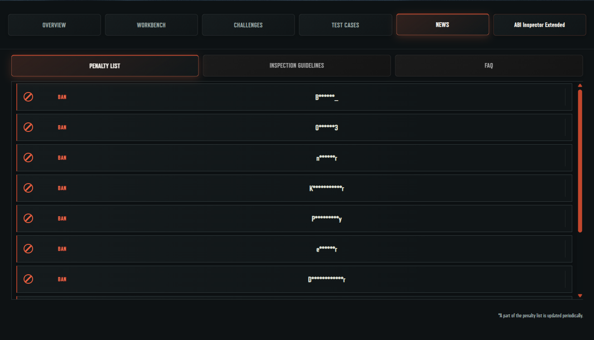 | 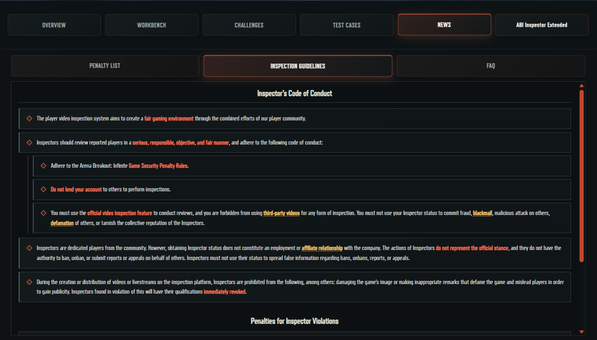 |

| FAQ |
| --- |
| 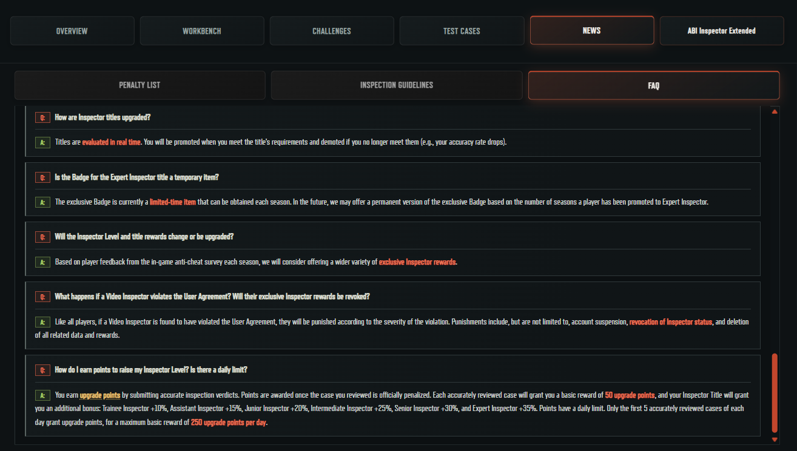 |

### Settings

| In-site extension settings |
| --- |
| 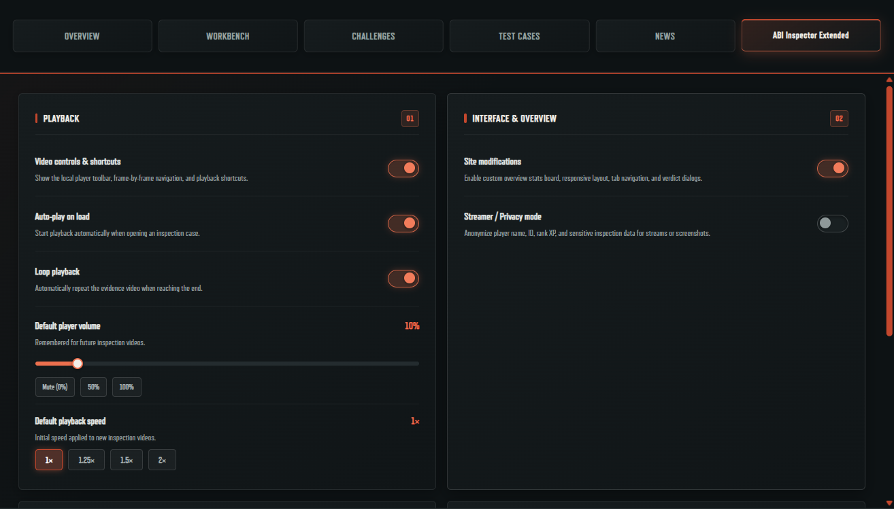 |

## Features

- **Accuracy Board overview:** Profile header, current rank and level progression, inspection accuracy percentage, historical volume, successful inspections, and ban statistics.
- **Detailed Overview with stacked progress bars:** 
  - Weekly and seasonal inspection stacked progress bars visually segment correct, wrong, and pending/unresolved inspections.
  - Interactive hover tooltips display exact counts and percentage breakdowns.
  - Smooth loading bar animations on tab navigation.
  - Daily inspection counters, today's allowance, current-level XP, remaining XP, and cumulative XP.
  - All metrics render from existing Inspector responses without sending extra API requests.
- **Modern unified metallic UI:**
  - Dark metallic palette (`#13191c` / `#161f23`) with sleek `6px` rounded borders and subtle hover elevations.
  - Unified rounded button and card styling across Navigation, Overview, Workbench, Challenges, News tabs, and the top account bar.
  - Custom floating language picker and streamlined header actions without background clutters.
- **In-site Settings tab (`Settings`):**
  - Dedicated configuration tab on the Inspector site with instant reactive toggles and live status badges.
  - Customize Player Controls, Autoplay behavior, Site modifications, Overview enhancements, Anonymization defaults, and Verdict Dialog enhancements.
  - Optional **Quick verdict hotkeys** toggle for rapid keyboard review.
  - Single-click "Reset all to defaults" action.
- **Streamlined Extension Popup:**
  - One-click master on/off switch to activate or bypass all extension features instantly.
  - Direct shortcut button to open the comprehensive in-site settings tab.
  - Displays live connection status and version details.
- **Quick verdict hotkeys (Workbench):**
  - Instant verdict selection directly from your keyboard:
    - **`1`** or **`G`**: Violation
    - **`2`** or **`U`**: Uncertain
    - **`3`**, **`I`**, or **`C`**: No Violation
  - Disabled by default in Settings to prevent accidental submissions; can be enabled at any time.
- **Enhanced video controls & player fixes:**
  - Full playback bar: play/pause, 5-second & 10-second jumps, frame stepping (~1/30s), playback speed multiplier (0.1× to 3×), volume slider, and fullscreen.
  - **Screen-click play/pause:** Click directly on the video screen/container to pause or resume playback.
  - **Reliable playback speed retention:** Adjusting playback speed persists reliably across pauses, unpauses, and case switches without snapping back to 1×.
  - **Autoplay safety:** Videos auto-start on load if autoplay is enabled, but never override user pauses or repeatedly loop unexpected play states.
- **Screenshot anonymization:**
  - Account toolbar and settings toggle to anonymize names, account IDs, ranks, levels, and inspection numbers with `***`.
  - Easy toggle between Anonymize and Unanonymize for safe sharing and recording.
- **Workbench and Test Cases:** Shared player layout, official inspection notes, team/enemy/Scav color references, and native verdict controls.
- **Restyled verdict dialogs & Quick-Tag Reason Chips:** Modernized modal styling, one-click localized quick-tag reason chips (Wallhack / Pre-aiming, Aimbot / Instant Snap, Abnormal Speed / Movement, No Recoil, Macro, Lag Switching, Rage Cheating), English/localized placeholders, character limits (`x / 50`), and category counters (`x / 3 selected`) while preserving official submission behaviors.

## Install

1. Download or clone this repository and keep it in a permanent folder.
2. Open `chrome://extensions` in Chrome or `edge://extensions` in Edge.
3. Turn on **Developer mode** and select **Load unpacked**.
4. Choose the `abi-inspector-enhancer` folder, which contains `manifest.json`.
5. Open or reload the Inspector page.

After changing extension files, reload the extension from the browser’s Extensions page, then refresh the Inspector tab. Disable or remove the extension and refresh the page to return to the original presentation.

The extension is scoped to the official Inspector page:

[`https://www.arenabreakoutinfinite.com/act/a20251028patroller/`](https://www.arenabreakoutinfinite.com/act/a20251028patroller/)

## Settings

### Extension Popup
Click the extension icon in your browser toolbar to access the master toggle. This lets you enable or disable all extension features with one click. Use the **Open On-Site Settings** button to jump directly to the Inspector settings hub.

### In-Site Settings Hub
Inside the Inspector navigation bar, click the **Settings** tab to fine-tune preferences:
- **Master Switches:** Extension features on/off.
- **Playback & Controls:** Player controls overlay, Autoplay on case open, default audio volume.
- **Interface & Layout:** Site UI enhancements, Overview enhancements, Anonymize personal details by default.
- **Workbench & Verdicts:** Verdict dialog enhancements, Quick verdict hotkeys.
- **Reset:** Restore all configuration values back to factory defaults.

## Keyboard shortcuts

Shortcuts apply while using the page or player. They are ignored while typing in form fields and while focus is on buttons, links, dialogs, or the extension’s sliders.

### Player & Navigation Shortcuts

| Action | Shortcut |
| --- | --- |
| Play / pause | `Space` or `K` (or click video) |
| Back / forward 5 seconds | `J` / `L` or `←` / `→` |
| Previous / next frame | `,` / `.` |
| Slow down / speed up | `[` / `]` |
| Reset speed to 1× | `\` or click the speed value |
| Mute / unmute | `M` |
| Fullscreen / exit fullscreen | `F` / `Esc` |

### Quick Verdict Shortcuts (Workbench)

*Note: Quick verdict hotkeys must be enabled under the in-site **Settings** tab.*

| Verdict | Key |
| --- | --- |
| **Violation** | `1` or `G` |
| **Uncertain** | `2` or `U` |
| **No Violation** | `3`, `I`, or `C` |

## Privacy and compatibility

The Manifest V3 extension declares the `storage` permission for preferences and saved player volume. Its content scripts are limited to the official Inspector page. It uses no external scripts, CDNs, analytics, or telemetry. It does not fetch or extract video URLs, modify or cover the video watermark, submit verdicts, or automate inspections. The official video, overlays, inspection controls, and verdict actions remain part of the page.

The controls require the official working player; training and drill players are intentionally excluded. Browser media behavior, the site’s own media limits, and future changes to the Inspector page can affect compatibility. Use a current version of Chrome or Edge.

## Source map

Overview checks: install development dependencies, then run `npm run check` and `npm test`. The browser test uses installed Edge on Windows, or Playwright Chromium elsewhere; set `ABI_TEST_BROWSER` to override. Reload the main Inspector extension and refresh the Inspector page after updating so the summary listener runs from page startup. The separate Network Reader is not required for the Overview features.

- `abi-inspector-enhancer/manifest.json` — extension configuration and page scope.
- `abi-inspector-enhancer/settings.js` and `popup.*` — preferences and master toggle popup interface.
- `abi-inspector-enhancer/content.js` and `player.css` — video controls, screen-click pause, hotkeys, and player layout.
- `abi-inspector-enhancer/layout.css` and `site-ui.js` — metallic card styling, navigation, stacked inspection progress bars, and in-site settings hub.
- `abi-inspector-enhancer/overview-observer.js` and `overview-data.js` — read existing summary responses and relay only numeric statistics to Overview, without changing network traffic.
- `abi-inspector-enhancer/dialogs.js` and `dialogs.css` — verdict-dialog presentation and type counters.
- `abi-inspector-enhancer/icons/` and `assets/` — browser icons and source artwork.
- `screenshots/` — UI captures for Overview, Workbench, Challenges, Test Cases, News, verdict dialogs, and settings.
- `tests/` — automated test suites for Overview DOM rendering and Player control reliability.

## Credits

The project uses locally bundled [Font Awesome Free 6.7.2](https://fontawesome.com/license/free) icons under CC BY 4.0. Attribution and license details are in [`abi-inspector-enhancer/THIRD_PARTY_NOTICES.md`](abi-inspector-enhancer/THIRD_PARTY_NOTICES.md).

This is an independent interface enhancement. Use it in accordance with the applicable Inspector rules and terms.

